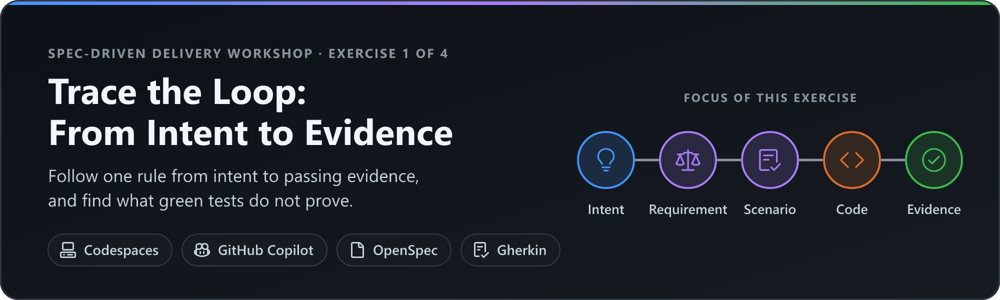
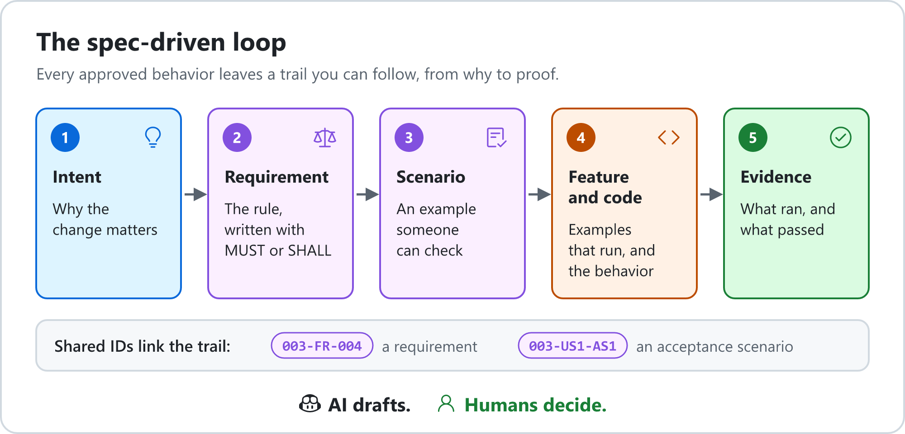
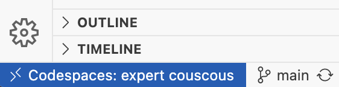
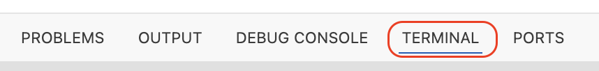

## Step 1: Follow one behavior from intent to evidence



Welcome to the Contoso Health Plan delivery team, @{{ login }}! :wave: Your team is building inbound document triage: faxes and scans must reach the right queue fast, attach to a member only when certain, and go to people whenever the system is unsure. Before the next planning session, your lead asks you to show how one business rule travels from intent to evidence.

### 📖 Theory: The spec-driven loop

In spec-driven delivery, every behavior leaves a trail. An **intent brief** explains why the change matters. An [OpenSpec](https://github.com/Fission-AI/OpenSpec) **change** holds the proposal and the **requirements** (rules written with MUST or SHALL), each with acceptance **scenarios**. A [Gherkin](https://cucumber.io/docs/gherkin/reference/) **feature** file turns scenarios into examples a machine can run, and the **code** and **tests** produce the evidence. Shared IDs link the trail: `003-FR-004` is a requirement and `003-US1-AS1` is an acceptance scenario.



| Link | Where it lives in this repository |
| --- | --- |
| Intent | `intent/document-triage-brief.md` |
| Requirement and scenario | `openspec/changes/add-inbound-document-triage/specs/inbound-document-triage/spec.md` |
| Feature | `features/document-triage.feature` |
| Code and evidence | `src/document-triage.js`, `npm run test:bdd` |

### ⌨️ Activity 1: Open your codespace

Your copy of this repository comes with a ready-made [codespace](https://docs.github.com/en/codespaces/overview): an online editor with Node.js, Cucumber.js and the OpenSpec command-line tool already installed.

1. Right-click the button below and open it in a new tab, so you can keep these instructions open.

   [](https://codespaces.new/{{ full_repo_name }}?quickstart=1)

1. On the codespace page, check that the repository is `{{ full_repo_name }}`, your copy, and not the original exercise. Then select **Create new codespace**. If you already have a codespace for this repository, the page offers **Resume this codespace** instead; that works too.

1. Wait for the editor to open. The first start takes about 2 to 4 minutes, because the codespace installs everything this exercise needs before it opens.

   > ⏳ **Wait:** You are ready when the bottom-left corner of the editor shows **Codespaces** followed by your codespace's name.

   

1. Open a terminal with `` Ctrl+` `` (also on Mac), or from the menu (☰) at the top left with **Terminal** > **New Terminal**. Then create a branch for your work.

   > 
   >
   > ```bash
   > git switch -c trace-triage
   > ```

   The terminal shows `Switched to a new branch 'trace-triage'`.

<details>
<summary>Having trouble? 🤷</summary><br/>

- **No terminal is visible:** In the panel at the bottom of the editor, select the **TERMINAL** tab. If there is no panel, press `` Ctrl+` `` (also on Mac).

  

- **The codespace opened the original exercise:** Close that tab and use the button above, which points to your copy. You can also start one from your repository page: **Code** > **Codespaces** > **Create codespace on main**.

- **A command says a package is missing:** The setup did not finish. Run `npm ci` in the terminal, then try again.

</details>

### ⌨️ Activity 2: Follow the trace

You'll follow scenario `003-US1-AS1`, the rule that decides whether a document is routed automatically or by a person. To open a file by name, press `Ctrl+P` (`Cmd+P` on Mac) and type part of its name.

1. Open `intent/document-triage-brief.md`. In the prompt near the end, find the line `auto-route confident ones, send the rest to people`. That is the **intent**.

1. Open `openspec/changes/add-inbound-document-triage/specs/inbound-document-triage/spec.md` and find `### Requirement: 003-FR-004`. Read the requirement, then its first scenario, `003-US1-AS1`: claim forms at 0.96 and 0.72 against a 0.90 threshold.

1. Open `features/document-triage.feature`. The first scenario carries the tags `@003-US1-AS1 @003-FR-004`, so you know which rule it demonstrates. Notice its **Examples** table has three rows. The row for exactly 0.90 tests the boundary, which the spec's scenario does not mention.

1. Open `src/document-triage.js`. Find `threshold = 0.90` and the condition `confidence < threshold`, which sends a document to `human-review`.

1. Before you run anything, predict how many scenarios Cucumber will report for this tag. Then run it.

   > 
   >
   > ```bash
   > npm run test:bdd -- --tags @003-US1-AS1
   > ```

1. Near the end of the output, find `3 scenarios (3 passed)`. Each row of the **Examples** table runs as its own scenario.

<details>
<summary>Having trouble? 🤷</summary><br/>

- **`cucumber-js: not found`:** The setup did not finish. Run `npm ci`, then run the command again.

- **`0 scenarios`:** Check the tag. It starts with `@` and uses capital letters: `@003-US1-AS1`.

- **An `ENOENT` error that mentions `@003-US1-AS1`:** Keep the `--` before `--tags`. It passes the tag to Cucumber instead of npm.

</details>

### ⌨️ Activity 3: Record the trace and push it

1. Open `trace/document-triage.md`. Replace the whole **Trace 1** table with this one, and keep the `## Trace 1` heading above it:

   ```markdown
   | Link | What you found |
   | --- | --- |
   | Intent | Brief prompt: "Classify each document with a confidence score; auto-route confident ones, send the rest to people." |
   | Requirement | 003-FR-004: auto-route only non-Other documents at or above their type's threshold; the rest go to human review with a reason |
   | Scenario | 003-US1-AS1: claim forms at 0.96 and 0.72 against a 0.90 threshold |
   | Feature | features/document-triage.feature, "Confidence determines who routes a claim form" (0.96, 0.90 and 0.72) |
   | Code | src/document-triage.js, triageDocument: confidence < threshold sends the document to human-review |
   | Evidence | npm run test:bdd -- --tags @003-US1-AS1: 3 scenarios (3 passed) |
   | Not proven by the evidence | That a document sent to human review carries a reason, and that Operations can change a type's threshold (003-FR-005) |
   ```

   > 💡 **Tip:** Read the last row twice. The requirement says "with a reason", but no `Then` step checks for one. Green evidence proves only what its checks assert.

1. Save the file, then commit and push your branch.

   > 
   >
   > ```bash
   > git add trace/document-triage.md
   > git commit -m "Trace 003-US1-AS1 from intent to evidence"
   > git push -u origin trace-triage
   > ```

1. Go back to this issue in your browser. Wait a moment for Mona to check your work, provide feedback, and share the next lesson.

<details>
<summary>Having trouble? 🤷</summary><br/>

- **`git push` asks for credentials or is rejected:** Make sure the codespace belongs to your copy, `{{ full_repo_name }}`. Run `git remote -v` to check.

- **`git commit` says `nothing to commit`:** Save the worksheet with `Ctrl+S` (`Cmd+S` on Mac), then run the three commands again.

- **Mona did not respond:** Check that `git push` finished without an error, and run `git branch --show-current`. If the branch isn't `trace-triage`, run `git switch -c trace-triage`, then `git push -u origin trace-triage`. You can watch the run in the [Actions tab](https://github.com/{{ full_repo_name }}/actions).

- **Mona reported a failed check:** Fix the worksheet, then commit and push again. Mona checks every push to `trace-triage`.

</details>
