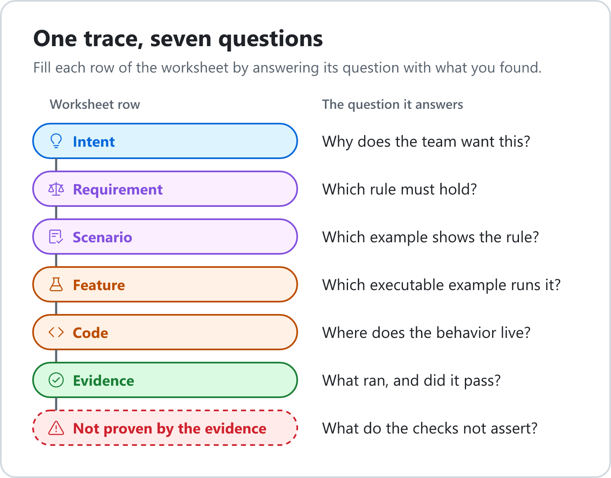

## Step 2: Find where the evidence stops

Nice trace, @{{ login }}! Your lead has a sharper question now: "Our weekend appeal scenario is green. Does that mean the on-call team will hear about urgent weekend appeals?" This time you'll trace the rule yourself.

### 📖 Theory: What a passing scenario proves

A passing scenario proves only what its `Then` steps assert. The spec's `THEN` line can promise more than the Gherkin `Then` step checks, and the feature's requirement tag shows which rule the example was written to demonstrate. When they differ, record the unproven part in plain words. Don't edit tags or scenarios to make the trace look complete: a conflict between artifacts is a finding for a person to resolve.

Each row of your worksheet answers one question:



### ⌨️ Activity: Trace the weekend appeal rule

1. Before you scroll up, try to name from memory the places you visited in step 1, in order. Then check yourself.

   <details>
   <summary>Show the trail</summary>

   Intent brief, then the requirement and its scenario in the OpenSpec change, then the Gherkin feature, then the code, then the test evidence.

   </details>

1. In your codespace, search the whole repository for `003-US4-AS3` with `Ctrl+Shift+F` (`Cmd+Shift+F` on Mac). It appears in the spec, the feature file and a unit test.

1. In the spec, note which `### Requirement:` heading the scenario sits under, and read its `THEN` line word by word.

1. In `features/document-triage.feature`, note the scenario's tags and its `Then` step.

1. In `src/document-triage.js`, find `clockStartsAt` and `priority`, the two values the test reads.

1. Predict which part of the spec's `THEN` line the test checks. Then run the scenario.

   > 
   >
   > ```bash
   > npm run test:bdd -- --tags @003-US4-AS3
   > ```

1. In `trace/document-triage.md`, fill in every row of the **Trace 2** table in your own words. For **Intent**, the brief's prompt has one line about appeals. For **Evidence**, copy the summary line Cucumber printed. In **Not proven by the evidence**, name what the spec's `THEN` line promises that the test does not check.

1. Save, commit with your own message, and push to `trace-triage` as you did in step 1.

1. Go back to this issue in your browser. Wait a moment for Mona to check your work, provide feedback, and share the next lesson.

<details>
<summary>Having trouble? 🤷</summary><br/>

- **The spec and the feature point to different requirements:** That's a real finding, not your mistake. Write both IDs in the **Requirement** row and say which is which. Don't change the tag.

- **Mona says the Not proven by the evidence row is missing something:** Put the spec's `THEN` line next to the Gherkin `Then` step. Which part of the spec's line has no matching check?

- **Mona says the evidence row is missing:** Paste the summary line that ends in `passed` from the test output.

- **Mona did not respond:** Check that you pushed to `trace-triage` and that the worksheet changed. You can watch the run in the [Actions tab](https://github.com/{{ full_repo_name }}/actions).

</details>
