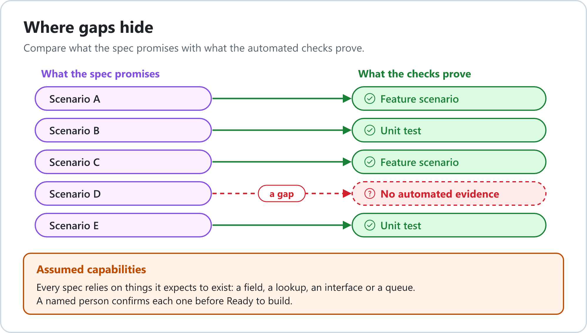
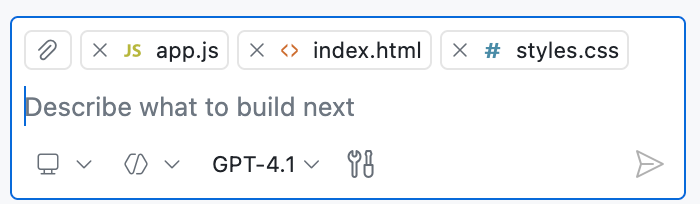
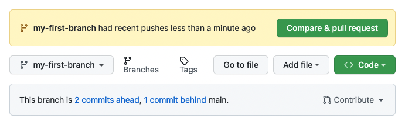

## Step 3: Record a gap and open a pull request

Great catch, @{{ login }}! You found a promise the evidence does not keep. One question remains before planning: what else is still unproven or unconfirmed? You'll answer it with Copilot's help, check the answer yourself, and share your trace in a pull request.

### 📖 Theory: Gaps and unconfirmed capabilities

A spec can keep acceptance scenarios that no automated check covers yet, and every spec rests on **capabilities** it assumes exist: a field, a lookup, an interface or a queue. [Copilot Chat](https://docs.github.com/en/copilot/how-tos/chat-with-copilot/chat-in-ide) is good at comparing files to find candidate gaps, but it can be wrong, and only a named owner, such as the engineering lead for that system, can confirm that a capability exists. Until someone does, the capability blocks the **Ready to build** decision. The rule for the whole workshop: AI drafts, humans decide.



### ⌨️ Activity 1: Find a gap with Copilot

1. In your codespace, open Copilot Chat: select the chat icon at the top of the editor, or press `Ctrl+Alt+I` (`Ctrl+Cmd+I` on Mac).

1. Ask Copilot to compare the spec with the evidence. The first sentence keeps it read-only.

   > 
   >
   > ```prompt
   > Do not edit any files. List every "#### Scenario:" ID in
   > openspec/changes/add-inbound-document-triage/specs/inbound-document-triage/spec.md
   > that does not appear in features/document-triage.feature or tests/document-triage.test.js.
   > For each one, quote its THEN line.
   > ```

   > 💡 **Tip:** If Copilot answers without reading the files, add them to the chat: type `#` in the chat box and pick each file. Each file you add appears above your prompt.
   >
   > 

1. Pick one ID from the list and verify it yourself: search the repository for it with `Ctrl+Shift+F` (`Cmd+Shift+F` on Mac). It should appear only in the spec.

1. Open `openspec/changes/add-inbound-document-triage/design.md` and read the first decision. It lists what the first slice receives as input instead of doing itself. Each of those is a capability someone must confirm exists.

1. In `trace/document-triage.md`, fill in the **Gaps** section. Write each answer after its label's colon, on the same line:

   - **Scenario with no automated evidence:** the ID you verified.
   - **Why it matters:** one sentence on the risk if nobody checks it.
   - **Unconfirmed capability:** a capability the spec assumes exists, in a short sentence.
   - **Who could confirm it:** a role, such as "Engineering lead, Operations Platform". Use roles, not real names.

<details>
<summary>Having trouble? 🤷</summary><br/>

- **Your search finds a listed ID in the feature file or a unit test:** Copilot can be wrong. Drop that ID and pick one your search finds only in the spec. Checking AI output like this is part of the job.

- **Copilot stops answering or says you've reached a limit:** The prompt only saves time. Compare the `#### Scenario:` IDs in the spec with the tags in `features/document-triage.feature` and the unit test names yourself.

- **Copilot edited a file:** Undo it with `git restore <file>`, then ask again.

- **No chat icon, or Copilot asks you to sign in:** Select the Copilot icon in the Status Bar at the bottom of the editor and sign in with your GitHub account. The GitHub Copilot Chat extension is already installed in this codespace.

</details>

### ⌨️ Activity 2: Open a pull request

1. Save, commit with your own message, and push to `trace-triage`.

1. In your browser, go to your repository, `{{ full_repo_name }}`. Open the **Pull requests** tab and [create a pull request](https://docs.github.com/en/pull-requests/collaborating-with-pull-requests/proposing-changes-to-your-work-with-pull-requests/creating-a-pull-request) with `main` as the base branch and `trace-triage` as the compare branch.

   > 💡 **Tip:** If a **Compare & pull request** banner appears for `trace-triage`, you can use it instead.

   

1. Give it a short title, such as `Trace inbound document triage`, and create the pull request.

1. Go back to the exercise issue. Wait a moment for Mona to check your work, provide feedback, and share the next lesson.

<details>
<summary>Having trouble? 🤷</summary><br/>

- **Mona says the Gaps section doesn't name a scenario with no automated evidence:** Choose a `#### Scenario:` ID from the spec that does not appear in `features/document-triage.feature` or in a unit test name. Copy it exactly as the spec writes it, with capital letters. Fix the worksheet, then commit and push again. Mona checks the pull request again on every push.

- **Mona says the capability or the role is missing:** Write each one after its label's colon, on the same line. Describe the capability in a short sentence, not a single word.

- **You already opened a pull request from `trace-triage`:** Use it. Push a new commit to it, and Mona checks the pull request again.

- **Mona did not respond:** Check that the pull request targets `main`. If you changed the base branch of a pull request you had already opened, Mona doesn't notice: select **Close pull request**, then **Reopen pull request**, or push a new commit to `trace-triage`. You can watch the run in the [Actions tab](https://github.com/{{ full_repo_name }}/actions).

</details>
