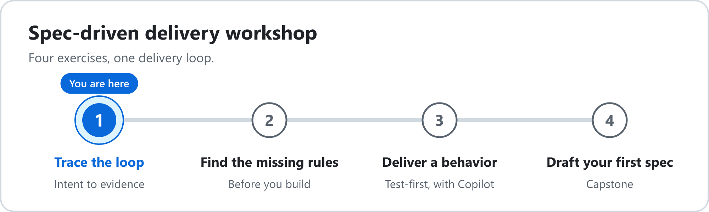

## Review

_Congratulations, you've completed this exercise and learned how to trace a business rule from intent to evidence, and how to say what the evidence does not prove!_

Here's a recap of what you accomplished:

- You followed one rule from the intent brief through its OpenSpec requirement, Gherkin scenario and code to a passing check.
- You traced a second rule on your own and named the part of its promise that the test does not check.
- You recorded a scenario with no automated evidence and an unconfirmed capability with a role who can confirm it.

Your pull request stays open for your team to read. You can merge it or close it; the exercise is complete either way.

### Check your understanding

Try to answer from memory before you peek. Recalling is what makes it stick.

Why can a green scenario leave a requirement unproven?
 

A scenario proves only what its `Then` steps assert. If the requirement or the spec's `THEN` line promises more, such as a reason for human review or an on-call notification, that part stays unproven until a check asserts it.

The spec lists 003-US4-AS3 under 003-FR-016, but the feature tags it 003-FR-014. What should you do?
 

Record the mismatch and ask the people who own the spec and the scenario to resolve it. Don't retag or edit the scenario on your own to make the trace look complete.

Copilot says a capability exists. Is that enough for Ready to build?
 

No. Copilot can find candidates, but only the system's owner, named by role, can confirm the capability. Until then it blocks the Ready to build decision.

### Take it to your work

Pick one acceptance criterion in your team's backlog. Name the automated check that proves it, and write one sentence on what that check does not prove.

### What's next?

- Continue the workshop with exercise 2, [Find the Missing Rules Before You Build](https://github.com/samueltauil/spec-driven-find-missing-rules), where you catch missing rules before anyone writes code.
- Read the [Gherkin reference](https://cucumber.io/docs/gherkin/reference/) to learn how scenarios, outlines and tags work.
- Explore more [GitHub Skills exercises](https://learn.github.com/skills).
